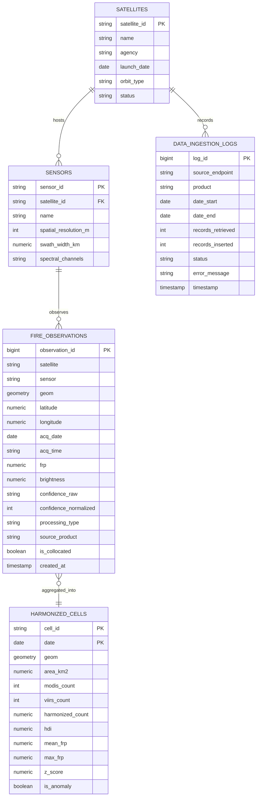

# FIRETRACE AI - Database Schema Specification

**Project:** FIRETRACE AI  
**Event:** NASA Space Apps Challenge 2026  
**Challenge:** Harmonization of MODIS and VIIRS Active Fire Hotspots  
**Team:** Astro-Avengers  
**Document Version:** 2.0 (PostgreSQL/PostGIS & SQLite/SpatiaLite Provenance Schema)

---

## 1. Architectural Overview

FIRETRACE AI utilizes a dual-tier persistence architecture designed for high-throughput satellite telemetry ingestion, rigorous provenance tracking, and sub-millisecond spatial-temporal filtering:

1. **Analytical / Production Store (PostgreSQL 15+ with PostGIS):**
   - High-performance relational geospatial database.
   - GIST indexing on 2D geometries (`GEOMETRY(Point, 4326)` for hotspots and `GEOMETRY(Polygon, 4326)` for sinusoidal equal-area cells).
   - Strict referential integrity enforcing satellite and sensor lineage.
2. **Local Edge & Provenance Store (SQLite 3 with In-Memory LRU & JSON Cache):**
   - Lightweight relational store (`firetrace.db`) for development, automated testing, and disconnected offline environments.
   - Provenance audit tracking (`data_ingestion_logs`, `satellites`, `sensors`).
   - Content-addressable JSON telemetry cache keyed by MD5 parameter digests (`cache/<md5>.json`).

---

## 2. Entity-Relationship Model



---

## 3. Table Definitions & DDL Specifications

### 3.1 `satellites` Table

Stores operational satellite mission metadata, launch dates, agencies, and orbital status.

| Column | Type | Constraints | Description |
|---|---|---|---|
| `satellite_id` | `VARCHAR(32)` | `PRIMARY KEY` | Satellite identifier (`TERRA`, `AQUA`, `SNPP`, `NOAA20`, `NOAA21`) |
| `name` | `VARCHAR(64)` | `NOT NULL` | Formal mission name |
| `agency` | `VARCHAR(32)` | `DEFAULT 'NASA'` | Operating space agencies (`NASA`, `NASA/NOAA`) |
| `launch_date` | `DATE` | `NOT NULL` | Mission launch date (enforces valid historical start boundary) |
| `orbit_type` | `VARCHAR(32)` | `DEFAULT 'Sun-synchronous'` | Orbital classification |
| `status` | `VARCHAR(16)` | `DEFAULT 'active'` | Operational status (`active`, `decommissioned`) |

### 3.2 `sensors` Table

Stores sensor-specific optical and radiometric properties necessary for inter-sensor calibration.

| Column | Type | Constraints | Description |
|---|---|---|---|
| `sensor_id` | `VARCHAR(32)` | `PRIMARY KEY` | Sensor ID (`MODIS_TERRA`, `MODIS_AQUA`, `VIIRS_SNPP`, etc.) |
| `satellite_id` | `VARCHAR(32)` | `REFERENCES satellites(satellite_id)` | Foreign key to host satellite |
| `name` | `VARCHAR(64)` | `NOT NULL` | Full instrument name |
| `spatial_resolution_m` | `INTEGER` | `NOT NULL` | Nadir spatial resolution in meters (1000 m for MODIS, 375 m for VIIRS) |
| `swath_width_km` | `NUMERIC(8,2)` | `NOT NULL` | Ground swath width in km (2330 km MODIS, 3040 km VIIRS) |
| `spectral_channels` | `VARCHAR(128)` | | Detection bands used in active fire algorithm |

### 3.3 `fire_observations` Table

Immutable store of raw active fire hotspot detections ingested from NASA FIRMS. Original physical values are strictly preserved.

| Column | Type | Constraints | Description |
|---|---|---|---|
| `observation_id` | `BIGSERIAL` | `PRIMARY KEY` | Unique synthetic identifier |
| `satellite` | `VARCHAR(32)` | `NOT NULL` | Source satellite mission identifier |
| `sensor` | `VARCHAR(32)` | `NOT NULL` | Instrument type (`MODIS` or `VIIRS`) |
| `geom` | `GEOMETRY(Point, 4326)` | `NOT NULL` | Spatial point coordinate in WGS 84 |
| `latitude` | `NUMERIC(8,4)` | `NOT NULL` | Observation latitude (-90.0 to 90.0) |
| `longitude` | `NUMERIC(8,4)` | `NOT NULL` | Observation longitude (-180.0 to 180.0) |
| `acq_date` | `DATE` | `NOT NULL` | UTC acquisition date |
| `acq_time` | `VARCHAR(4)` | `NOT NULL` | UTC acquisition time (HHMM format) |
| `frp` | `NUMERIC(8,2)` | | Fire Radiative Power in MegaWatts (MW) |
| `brightness` | `NUMERIC(8,2)` | | Mid-infrared brightness temperature (Kelvin) |
| `confidence_raw` | `VARCHAR(16)` | `NOT NULL` | Original source confidence (`0-100%` or `l`/`n`/`h`) |
| `confidence_normalized`| `INTEGER` | `NOT NULL` | Inter-calibrated confidence scale (`0-100`) |
| `processing_type` | `VARCHAR(8)` | `NOT NULL` | Ingestion pipeline (`NRT` for near-real-time, `SP` for standard archive) |
| `source_product` | `VARCHAR(64)` | `NOT NULL` | NASA product identifier (e.g. `MODIS_SP`, `VIIRS_SNPP_NRT`) |
| `is_collocated` | `BOOLEAN` | `DEFAULT FALSE` | True if identified as a cross-sensor overlapping pass |
| `created_at` | `TIMESTAMP WITH TZ`| `DEFAULT NOW()` | Ingestion timestamp |

### 3.4 `harmonized_cells` Table

Pre-computed and on-demand spatial aggregations across the 10 km sinusoidal equal-area grid.

| Column | Type | Constraints | Description |
|---|---|---|---|
| `cell_id` | `VARCHAR(64)` | `NOT NULL` | Sinusoidal cell identifier (`SINO_10KM_R{row}_C{col}`) |
| `date` | `DATE` | `NOT NULL` | Observation date |
| `geom` | `GEOMETRY(Polygon, 4326)`| `NOT NULL` | Closed 4-vertex equal-area grid cell boundary |
| `area_km2` | `NUMERIC(8,2)` | `NOT NULL` | Fixed cell area (100.00 km²) |
| `modis_count` | `INTEGER` | `DEFAULT 0` | Raw MODIS hotspot detections in cell |
| `viirs_count` | `INTEGER` | `DEFAULT 0` | Raw VIIRS hotspot detections in cell |
| `harmonized_count` | `NUMERIC(10,2)`| `NOT NULL` | Scaled count: $N_{\text{MODIS}} + \alpha(m) \cdot N_{\text{VIIRS}}$ |
| `hdi` | `NUMERIC(10,4)`| `NOT NULL` | Hotspot Density Index per $1000\text{ km}^2$ |
| `mean_frp` | `NUMERIC(8,2)` | | Mean Fire Radiative Power (MW) |
| `max_frp` | `NUMERIC(8,2)` | | Maximum observed FRP (MW) |
| `z_score` | `NUMERIC(8,4)` | | Standardized Z-Score against historical baseline |
| `is_anomaly` | `BOOLEAN` | `DEFAULT FALSE` | True if $|Z| > 1.5$ |

**Composite Primary Key:** `(cell_id, date)`

### 3.5 `data_ingestion_logs` Table

Full data provenance and system health audit trail.

| Column | Type | Constraints | Description |
|---|---|---|---|
| `log_id` | `BIGSERIAL` | `PRIMARY KEY` | Incremental log entry ID |
| `source_endpoint` | `VARCHAR(256)` | `NOT NULL` | NASA FIRMS endpoint URL or fallback engine |
| `product` | `VARCHAR(64)` | `NOT NULL` | Product requested |
| `date_start` | `DATE` | `NOT NULL` | Ingestion window start |
| `date_end` | `DATE` | `NOT NULL` | Ingestion window end |
| `records_retrieved` | `INTEGER` | `NOT NULL` | Telemetry records downloaded |
| `records_inserted` | `INTEGER` | `NOT NULL` | New records inserted into store |
| `status` | `VARCHAR(32)` | `NOT NULL` | `SUCCESS`, `PARTIAL`, `FAILED`, `SYNTHETIC_FALLBACK` |
| `error_message` | `TEXT` | | Detailed diagnostic trace on failure |
| `timestamp` | `TIMESTAMP WITH TZ`| `DEFAULT NOW()` | Event log timestamp |

---

## 4. Indexing & Query Optimization Strategy

1. **Spatial Indexes:**
   ```sql
   CREATE INDEX idx_fire_obs_geom ON fire_observations USING GIST(geom);
   CREATE INDEX idx_harm_cells_geom ON harmonized_cells USING GIST(geom);
   ```
   Accelerates bounding box queries (`ST_Intersects`, `ST_MakeEnvelope`) from $O(N)$ scan to $O(\log N)$ R-Tree traversal.

2. **Temporal & Filter Indexes:**
   ```sql
   CREATE INDEX idx_fire_obs_date ON fire_observations(acq_date);
   CREATE INDEX idx_fire_obs_sensor ON fire_observations(sensor);
   CREATE INDEX idx_fire_obs_sat_date ON fire_observations(satellite, acq_date);
   CREATE INDEX idx_harm_cells_date ON harmonized_cells(date);
   ```

3. **Compound Partitioning Recommendation (Global Deployment):**
   - Range-partitioning `fire_observations` by `acq_date` (annual partitions from 2000 through 2026).
   - Allows drop-in archival of older decadal data without rebuilding active tables.

